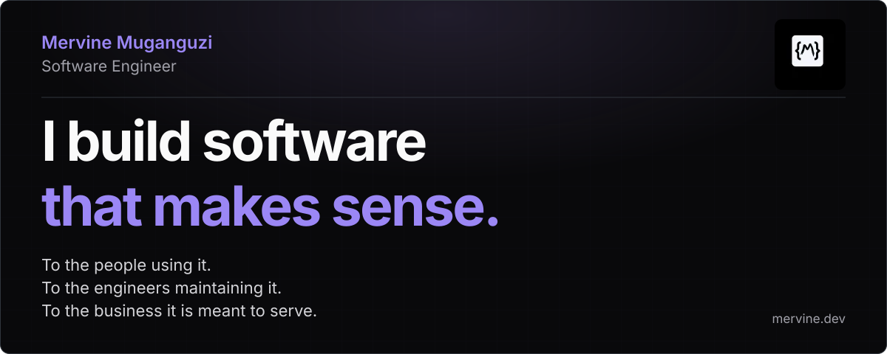

<a href="https://www.mervine.dev/">
  <picture>
    <source media="(max-width: 600px)" srcset="./assets/profile/website-header-compact.svg" />
    
  </picture>
</a>

  <a href="https://www.mervine.dev/">Website</a>
  &nbsp;·&nbsp;
  <a href="https://www.linkedin.com/in/mervine-muganguzi-981568236/">LinkedIn</a>
  &nbsp;·&nbsp;
  <a href="https://www.mervine.dev/#contact">Contact</a>

I'm Mervine, a software engineer based in Kaunas, Lithuania. I have an MSc in Computer Engineering, and I build web apps, mobile apps, and the services behind them. I also research how AI coding agents fail and how to evaluate their work.

I'm looking for a backend or full-stack engineering role in Lithuania, or a remote role in Europe.

## Public projects

### [Webhook Relay](https://github.com/MerveilleDivine/webhook-relay)

I built this to work through what happens when requests are repeated, a receiver goes offline, or a worker stops during delivery. It saves events in SQLite, sends signed webhooks, and retries temporary failures. The tests cover the API, concurrent workers, and recovery after a crash.

Python · SQLite · HTTP APIs · Integration tests

### [Remote Job Search](https://github.com/MerveilleDivine/remote-job-search)

I built a Python client to search JSearch listings, filter remote roles, and export results. The command line and browser interface share one API client, with retries, duplicate handling, safe CSV exports, and offline tests.

Python · Gradio · REST APIs

### [CPU Scheduler Simulator](https://github.com/MerveilleDivine/cpu-scheduler-simulator)

This started as my university operating systems project. I later refactored it to compare five scheduling algorithms on the same input, with timelines, scheduling metrics, and JSON reports.

C++ · CMake · CTest

### [Papa AI Toolbox](https://github.com/MerveilleDivine/papa-ai-toolbox)

I made this for my father to help him try AI tools in French. It gives him explanations and example prompts, with search, shareable filters, and favourites saved in his browser.

React · TypeScript · Vitest

### [CIFAR-10 Image Classifier](https://github.com/MerveilleDivine/cifar10-image-classifier)

I used PyTorch and ResNet-50 for this image classification project. Training, image processing, evaluation, and Gradio inference are separate modules so I can test and run each part on its own.

Python · PyTorch · Gradio

## Product work

The source for these projects is private. Each case study shows my work, the decisions I made, and what is ready or still in progress.

### [CAB Music](https://www.mervine.dev/projects/cab-music)

I'm building a music academy platform with a public site and workspaces for students, instructors, and the owner. The frontend is implemented; hosted backend integration is in progress.

### [Covenant Connect / M&J](https://www.mervine.dev/projects/covenant-connect)

I built a private shared space for couples to plan their day, keep memories, pray, and talk. The web app is live at [covenant.mervine.dev](https://covenant.mervine.dev/). I'm still preparing the native app for release.

### [Norland RDC](https://www.mervine.dev/projects/norland-rdc)

I built the Next.js catalogue and product pages, with a separate path for prospective distributors. The catalogue is live; accounts, ordering, and payments are still being integrated.

### [LOOPS](https://www.mervine.dev/projects/loops)

I built a time-budgeting app for planning around the hours someone actually has, including split shifts and overnight work. A read-only interface is available while the account service is offline.

### [Equitas RDC](https://www.mervine.dev/projects/equitas-rdc)

I built the organisation's French and English website, including programme pages, responsive navigation, and contact handling. The site is live; online donations are awaiting payment-service activation.

## Research

My MSc thesis, *A Failure-Mode Analysis of an Agentic Coding System for Autonomous Software Engineering*, studied SWE-agent on SWE-bench Lite.

I reviewed 100 recorded runs, following the agent's code changes, tests, and attempts to recover from mistakes. In that evaluation, 53 runs resolved the task, and 21 of those met the study's stricter clean-resolution criteria.

## Technologies

Python · TypeScript · JavaScript · C · C++  
React · Next.js · React Native · FastAPI · Node.js  
PostgreSQL · Supabase · PyTorch · Docker · GitHub Actions

[More about me](https://www.mervine.dev/#about) · [Get in touch](https://www.mervine.dev/#contact)
